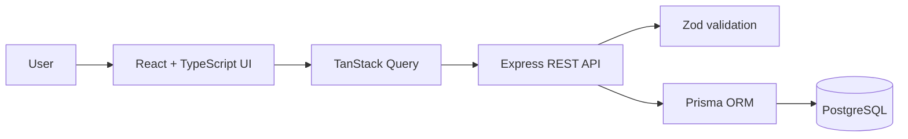

# Architecture

## Frontend
Feature-oriented pages consume API functions through TanStack Query. Shared layout, badges and styles are reusable. Directory pages currently include graceful fictional fallback data so the UI can be explored before the database is connected.

## Backend
Express routes expose JSON resources. Zod validates write payloads. Prisma provides typed database access. Central error middleware maps validation errors to HTTP 400 and unexpected errors to HTTP 500.

## Future architecture improvements
Add authentication middleware, RBAC policy checks, audit events, structured logging, pagination metadata, OpenAPI documentation and automated integration tests.

## Authentication and authorization
- Passwords are hashed with bcrypt (12 salt rounds); plaintext passwords are never persisted.
- The API issues an eight-hour JWT in an HTTP-only, SameSite=Lax cookie. The browser client sends credentials with API requests.
- Roles: `ADMIN`, `STUDY_COORDINATOR`, `INVESTIGATOR`.
- Admin can manage all resources and delete studies/sites. Study Coordinators can create and update studies/sites and manage participant records. Investigators can create/update participant records and read the workspace.
- The first account registered in an empty database is assigned Admin. Later self-registrations are Investigators. For a real deployment, disable public registration and implement an invitation/administrator workflow.
- Set a long, random `JWT_SECRET`, serve over HTTPS, add login rate limiting and review cookie/CORS settings before deployment.
